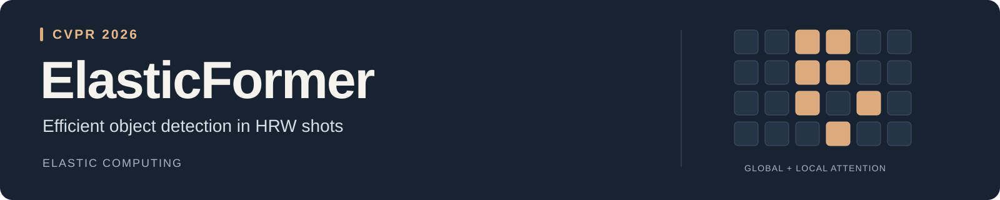
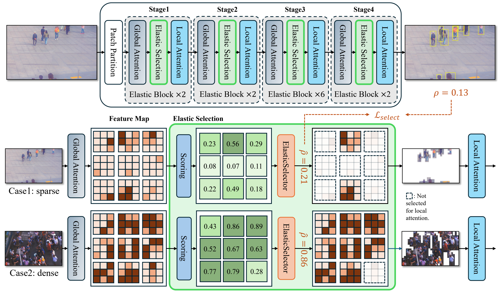

<div align="center">



<h2>Detecting Objects in HRW Shots via Elastic Computing Vision Transformer</h2>

<p>Wenxi Li<sup>*</sup>, Jingchen Huang<sup>*</sup>, Chenyang Lyu, Moran Liu,<br>Haozhe Lin, Guiguang Ding<sup>†</sup>, Yuchen Guo<sup>†</sup></p>
<p><sub><sup>*</sup> Equal contribution &nbsp; <sup>†</sup> Corresponding authors</sub></p>

<p>
  <a href="https://openaccess.thecvf.com/content/CVPR2026/papers/Li_ElasticFormer_Detecting_Objects_in_HRW_Shots_via_Elastic_Computing_Vision_CVPR_2026_paper.pdf"></a>
  <a href="docs/validation.md"></a>
  <a href="docs/validation.md"></a>
  <a href="LICENSE"></a>
</p>

<p>
  <a href="#overview">Overview</a> &nbsp;·&nbsp;
  <a href="#paper-results">Results</a> &nbsp;·&nbsp;
  <a href="#quick-start">Quick start</a> &nbsp;·&nbsp;
  <a href="#training">Training</a> &nbsp;·&nbsp;
  <a href="#evaluation">Evaluation</a> &nbsp;·&nbsp;
  <a href="#citation">Citation</a>
</p>

</div>

## Overview

ElasticFormer adapts the amount of computation to each image. ElasticSelector predicts foreground coverage and selects informative windows for local attention, while pooled global attention supplies context.

<p align="center">
  
  <br><sub>Architecture overview from the paper. <a href="docs/architecture.md">Read the method and training details →</a></sub>
</p>

| Component | What it does |
| :--- | :--- |
| **Adaptive computation** | Predict a separate window budget for each image and backbone stage. |
| **Global + local attention** | Use pooled tokens for global context and selected windows for local detail. |
| **Three-phase learning** | Stabilize the detector, train ElasticSelector, then optimize both jointly. |

## Paper results

PANDA results with DINO, reported in **Table 1 of the paper**. AP values are percentages; GFLOPs cover the backbone and neck.

| Model | AP<sub>50</sub> ↑ | AP<sub>small</sub> ↑ | AP<sub>medium</sub> ↑ | AP<sub>large</sub> ↑ | GFLOPs ↓ |
| :--- | ---: | ---: | ---: | ---: | ---: |
| DINO + Swin-T | 60.6 | 36.7 | 61.2 | 64.9 | 132.84 |
| DINO + SparseFormer | 78.0 | 50.8 | 78.1 | 82.3 | 75.71 |
| **DINO + ElasticFormer** | **80.6** | **51.5** | **80.2** | **84.9** | **13.13** |

The repository includes the backbone, DINO integration, training configurations, and PANDA inference/evaluation tools. **Trained weights are not included.** See the [validation record](docs/validation.md) for software checks.

This release covers ElasticFormer with DINO on PANDA. The separate ElasticNet and VOC weakly supervised experiments are outside its scope.

## Quick start

The validated environment uses **Python 3.10 · PyTorch 2.1 / CUDA 11.8 · MMCV 2.1 · MMEngine 0.10.7 · MMDetection 3.3**.

```bash
git clone https://github.com/Purecoo00/ElasticFormer.git
cd ElasticFormer

conda create -n elasticformer python=3.10 -y
conda activate elasticformer
pip install torch==2.1.0 torchvision==0.16.0 --index-url https://download.pytorch.org/whl/cu118
pip install mmcv==2.1.0 -f https://download.openmmlab.com/mmcv/dist/cu118/torch2.1/index.html
pip install -r requirements.txt
pip install -e . --no-deps
```

Use the MMCV wheel matching your PyTorch/CUDA build. DINO requires the compiled deformable-attention operator provided by `mmcv`.

Prepare COCO-format PANDA patches using the [data preparation guide](docs/data.md), then update the dataset paths in [the dataset configuration](configs/_base_/datasets/panda_detection.py).

## Training

The [released configuration](configs/dino/dino_elasticformer_t_4xb1_36e_panda.py) uses **36 epochs** and **one image per GPU**. This launcher uses 4 GPUs:

```bash
bash scripts/dist_train.sh configs/dino/dino_elasticformer_t_4xb1_36e_panda.py 4
```

| Phase | Epochs | ElasticSelector | Window budget |
| :--- | :--- | :--- | :--- |
| 1 | 1–24 | Frozen | All windows |
| 2 | 25–27 | Train with pseudo boxes | All windows |
| 3 | 28–36 | Jointly trained | Predicted per image |

The hook switches after **24 and 27 completed epochs**, including when resuming. Pseudo boxes supervise ElasticSelector; DINO's detection losses still use ground-truth annotations. Inference always uses predicted window budgets.

<details>
<summary><b>Single-GPU training, resuming, and GT selector supervision</b></summary>

```bash
# Train on one GPU.
python tools/train.py configs/dino/dino_elasticformer_t_4xb1_36e_panda.py

# Resume the latest checkpoint in a work directory.
python tools/train.py configs/dino/dino_elasticformer_t_4xb1_36e_panda.py \
  --work-dir work_dirs/elasticformer --resume

# Use GT boxes for the selector-supervision ablation.
python tools/train.py configs/dino/dino_elasticformer_t_4xb1_36e_panda.py \
  --cfg-options model.selector_supervision=gt
```

</details>

## Evaluation

```bash
bash scripts/dist_test.sh configs/dino/dino_elasticformer_t_4xb1_36e_panda.py path/to/checkpoint.pth 4
```

The standard configuration reports **patch-level COCO metrics**. For full-frame PANDA metrics, use tiled inference, merge detections in full-image coordinates, and apply the PANDA evaluator:

```bash
python tools/infer_tiles.py \
  configs/dino/dino_elasticformer_t_4xb1_36e_panda.py path/to/checkpoint.pth \
  --ann-file data/panda/full_frame_test.json \
  --image-root data/panda/full_frames \
  --out predictions.json --device cuda:0

python tools/evaluate_panda.py data/panda/full_frame_test.json predictions.json
```

See the [full-frame evaluation guide](docs/data.md#full-frame-inference-and-evaluation) for tiling options and PANDA-specific area ranges. Patch-level COCO scores and full-frame PANDA scores measure different evaluation settings.

## Validation

```bash
python -m pytest tests -q
python tools/smoke_test.py --device cuda:0
```

The synthetic smoke test exercises all three training phases, an optimizer step, and DINO inference. Tests cover per-image window budgets, sparse updates, foreground coverage, phase boundaries, and gradients. These checks validate code execution and training integration. Paper accuracy and runtime measurements are separate benchmark results.

## Code guide

| Entry | Source |
| :--- | :--- |
| Backbone | [`elasticformer.py`](elastic_former/models/backbones/elasticformer.py) |
| Detector and selector loss | [`elastic_dino.py`](elastic_former/models/detectors/elastic_dino.py) |
| Three-phase schedule | [`three_phase_hook.py`](elastic_former/engine/three_phase_hook.py) |
| Training configuration | [`dino_elasticformer_t_4xb1_36e_panda.py`](configs/dino/dino_elasticformer_t_4xb1_36e_panda.py) |
| Tiled inference | [`infer_tiles.py`](tools/infer_tiles.py) |
| PANDA evaluation | [`evaluate_panda.py`](tools/evaluate_panda.py) |
| Environment and checks | [Validation record](docs/validation.md) |

## Citation

If you use ElasticFormer in your research, please cite:

```bibtex
@inproceedings{li2026elasticformer,
  title={ElasticFormer: Detecting Objects in HRW Shots via Elastic Computing Vision Transformer},
  author={Li, Wenxi and Huang, Jingchen and Lyu, Chenyang and Liu, Moran and Lin, Haozhe and Ding, Guiguang and Guo, Yuchen},
  booktitle={Proceedings of the IEEE/CVF Conference on Computer Vision and Pattern Recognition},
  year={2026}
}
```

## Acknowledgments and license

Built with [MMDetection](https://github.com/open-mmlab/mmdetection), MMCV, and MMEngine. We thank [liwenxi/SparseFormer](https://github.com/liwenxi/SparseFormer) for the sparse detection framework and PANDA evaluator. See [NOTICE](NOTICE) for attribution. Code is distributed under the [Apache License 2.0](LICENSE).

---

<p align="center">
  <b>Related work</b> &nbsp; <a href="https://github.com/Purecoo00/BiHashFormer">BiHashFormer</a> &nbsp;·&nbsp;
  <a href="https://github.com/liwenxi/SparseFormer">SparseFormer</a>
  <br><sub>Efficient object detection in high-resolution, wide-field images.</sub>
</p>
